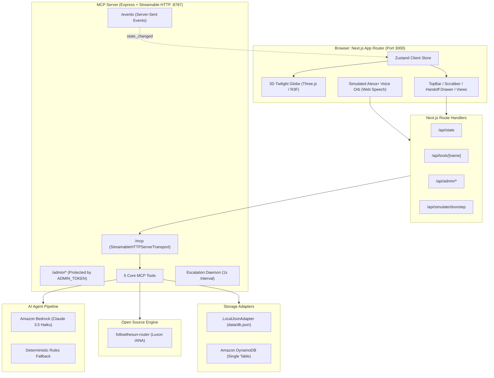

# LoadBearing 🌐⚖️

> **"Care shared fairly. Nothing falls between people."**

[](https://github.com/loadbearing/loadbearing/actions)
[](https://opensource.org/licenses/MIT)
[](https://nodejs.org/)
[](https://modelcontextprotocol.io/)

Built for the **Amazon Developer Hackathon**: Primary Track **Alexa+** (official self-hosted MCP server over Streamable HTTP with a browser-based simulated Alexa+ voice surface), plus the **AWS Builder** (Amazon Bedrock + Amazon DynamoDB) and **Open Source** (`followthesun-router` MIT package) challenges.

---

## 🏷️ Honest Labels Notice

| Component | Status | Details |
| :--- | :--- | :--- |
| **MCP Server** | **Real** | Official `@modelcontextprotocol/sdk` Streamable HTTP server on port `8787` implementing specification `2025-11-25` with stateful session management and SSE. |
| **Amazon Bedrock** | **Real** | Live AWS Bedrock runtime client using `ConverseCommand` (Anthropic Claude 3.5 Haiku) with deterministic JSON validation and automatic fallback circuit breaker. |
| **Amazon DynamoDB** | **Real** | Single-table DynamoDB adapter with conditional version writes, ACID transactions, and TTL pruning (`apps/mcp-server/src/storage/dynamo-adapter.ts`). |
| **Follow-the-Sun Router** | **Real** | Standalone deterministic TypeScript package (`followthesun-router`) with IANA time zones, sleep-tax multipliers, and load-rebalancing algorithms. |
| **Alexa+ Voice Surface** | *Simulated* | Browser-based voice surface using the Web Speech API (`SpeechRecognition` & `SpeechSynthesis`) and Web Audio AnalyserNode waveform. Not a physical Echo device. |
| **Doorstep Camera Events** | *Simulated* | Simulated front-doorbell triggers (delivery, unexpected visitor, regular courier) with 48-hour privacy expiration. |
| **Authentication** | *Demo Role Switch* | "View as" dropdown switches caregiver perspective. No passwords or OAuth in the demo world. |
| **Medical Disclaimer** | *Non-medical* | LoadBearing organizes family logistics and emotional continuity. It never provides medical diagnoses, advice, or emergency dispatch. |

---

## ⚡ 5-Command Quick Start

```bash
# 1. Clone repository
git clone https://github.com/loadbearing/loadbearing.git
cd loadbearing

# 2. Install dependencies (Node 20+)
npm ci

# 3. Configure environment
cp .env.example .env

# 4. Seed the demo world (Instant: 2026-10-22T16:30Z)
npm run seed

# 5. Start MCP server and Next.js Web App concurrently
npm run dev
```

Open [http://localhost:3000](http://localhost:3000) in your browser (Chrome or Edge recommended for Web Speech and WebGL2).

---

## 🔍 How Judges Verify the MCP Server

You can inspect the running LoadBearing MCP server directly using the official MCP Inspector:

```bash
npx @modelcontextprotocol/inspector
```

1. **Transport**: Select `Streamable HTTP` (or `HTTP`).
2. **URL**: Enter `http://localhost:8787/mcp`.
3. **Connect**: Click Connect. Notice protocol version `2025-11-25` negotiated with session headers.
4. **List Tools**: Exactly 5 registered production tools appear:
   - `capture_moment`: Emergency lexicon detection, moment classification, past-work crediting, and sleep-tax calculation.
   - `create_handoff`: Follow-the-Sun routing, awake window validation, local presence filtering, and explanatory rationale.
   - `record_resolution`: Acceptance, decline with automatic rerouting, and resolution with load attribution.
   - `propose_rebalance`: Multi-caregiver mutual consent check and fair-share rebalance proposals.
   - `get_continuity_brief`: Multilingual family continuity letters (English & Hindi) respecting privacy visibility.

---

## 📐 Architecture & Data Flow



---

## 🌍 The 3D Twilight Globe ("TwilightGlobe")

The 3D Twilight Globe visualizes the rhythm of distributed care work:
- **Pillars of Light**: Caregivers (Priya in Pune, Arjun in Berlin, Meera in Toronto) render as cylinders whose height dynamically springs to reflect their 7-day care load.
- **Awake / Asleep States**: Awake caregivers glow in warm **Lantern gold** (`#FFC66B`) with active halo rings; sleeping caregivers dim to **Moon indigo** (`#9AA3D6`) with a crescent moon indicator.
- **Day/Night Terminator**: Scrubbing the global clock moves the subsolar point and dynamically sweeps daylight across 7,000 instanced land dots.
- **Care Tokens**: 5 distinct 3D shapes with semantic color coding:
  - 🔵 **Contribution** (Disc, `#5B9CFF`)
  - 🟡 **Awaiting Acceptance** (Pulsing Torus, `#FFB547`)
  - 🔴 **Urgent Task** (Octahedron, `#FF7A7A`)
  - 🟣 **Family Memory** (4-Point Star, `#B08CFF`)
  - 🟢 **Resolved Work** (Disc with Check, `#5FD3A0`)
- **2D Fallback**: If WebGL is unavailable or toggled in accessibility settings, an SVG 24-hour time-zone strip displays the same data and actions.

---

## 🛠️ Environment Configuration (.env)

| Variable | Default | Purpose |
| :--- | :--- | :--- |
| `AWS_REGION` | `us-east-1` | AWS region for Bedrock and DynamoDB |
| `BEDROCK_MODEL_ID` | `anthropic.claude-3-5-haiku-20241022-v1:0` | Amazon Bedrock model ID |
| `AI_MODE` | `bedrock` | `bedrock` (with auto-fallback) or `rules` |
| `STORAGE` | `local` | `local` (JSON file mutex) or `dynamo` |
| `DYNAMO_TABLE` | `loadbearing-demo` | DynamoDB table name |
| `MCP_PORT` | `8787` | Port for the Express MCP server |
| `ADMIN_TOKEN` | `demo-admin-token` | Secret for protected clock/consent endpoints |
| `ACK_MINUTES` | `2` | Handoff escalation timeout in minutes (demo: 2, prod: 30) |
| `NEXT_PUBLIC_E2E` | `""` | Set to `1` during Playwright E2E tests |

---

## 🧪 Verification & Test Suite

Run the full verification suite with a single command:

```bash
npm run verify
```

This executes:
1. `typecheck`: Strict TypeScript checking with zero errors across all workspaces.
2. `lint`: ESLint enforcing TypeScript strict and React hooks guidelines with zero warnings.
3. `test`: 97+ Vitest unit tests covering domain models, routing math, DST transitions, and MCP protocol compliance.
4. `build`: Compiles `@loadbearing/shared`, `followthesun-router`, `apps/mcp-server`, and Next.js `apps/web`.
5. `demo:check`: Automated 10-step verification of the 2:45 demo arc.
6. `ai:smoke`: Bedrock runtime client validation and fallback verification.

---

## 📄 License

This project is licensed under the MIT License - see the [LICENSE](LICENSE) file for details.
The core routing package is published under `packages/router/` as `followthesun-router` for the Open Source track.
